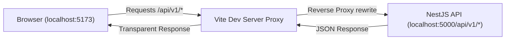

# Fitnex — Application Lifecycle & Technical Routing (APP_FLOW.md)

This document maps the technical lifecycle, request interception, routing, and error recovery in the Fitnex system.

---

## 1. Request / Response Lifecycle

```mermaid
flowchart TD
    Req["Incoming HTTP Request"] --> Cors["CORS Middleware"]
    Cors --> Guard["Global JwtAuthGuard"]
    
    Guard -->|Has @Public()| Pipe["ValidationPipe"]
    Guard -->|No @Public()| JwtCheck{"Validate Bearer Token"}
    
    JwtCheck -->|Valid Token| SetUser["Attach req.user"]
    SetUser --> Pipe
    
    JwtCheck -->|Missing / Expired| Err401["401 Unauthorized Exception"]
    
    Pipe -->|Validation Pass| Controller["Controller Handler"]
    Pipe -->|Validation Fail| Err400["400 Bad Request Exception"]
    
    Controller --> Service["Service Business Logic"]
    Service --> Mongo[("MongoDB Operation")]
    
    Mongo --> Interceptor["TransformInterceptor"]
    Interceptor --> Envelope["Wrap in Standard API Envelope { success, statusCode, data }"]
    Envelope --> Client["HTTP 200/201 Response to Client"]
```

---

## 2. Frontend Reverse Proxy Routing Flow



### Vite Proxy Configuration (`vite.config.js`):
```javascript
server: {
  proxy: {
    '/api': {
      target: 'http://localhost:5000',
      changeOrigin: true,
      secure: false,
    },
  },
}
```

---

## 3. Token Refresh Interceptor Flow

1. Client sends request with Bearer access token in `Authorization: Bearer <token>` header.
2. If access token expires, API returns `401 Unauthorized`.
3. Client API interceptor catches 401:
   - Queues pending outgoing requests.
   - Dispatches `POST /api/v1/auth/refresh` with stored refresh token.
   - If refresh succeeds: updates access token, replays queued requests.
   - If refresh fails (token revoked or expired): logs user out and navigates to `/auth`.
