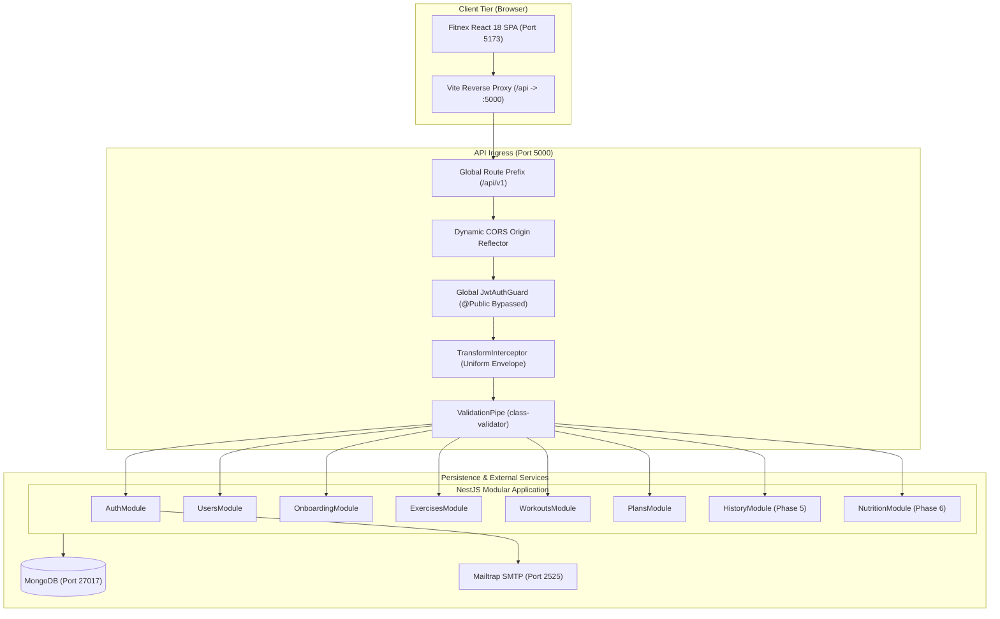

# Fitnex — System Architecture

**Architecture Style:** Modular Monolith (Clean Hexagonal / Domain-Driven Design)  
**Backend Framework:** NestJS 11 (TypeScript, Node.js)  
**Frontend Framework:** React 18 + Vite (SPA)  
**Database:** MongoDB 7 (Mongoose ODM)  
**Mail Transport:** Nodemailer with Mailtrap SMTP sandbox  
**Security Model:** Stateless JWT (Bearer Access Token + Refresh Token Rotation)

---

## 1. High-Level System Architecture



---

## 2. Architectural Patterns

### 2.1 Uniform Response Envelope
All successful API responses are normalized by the global `TransformInterceptor`:
```json
{
  "success": true,
  "statusCode": 200,
  "message": "Operation completed successfully",
  "data": { ... },
  "timestamp": "2026-11-25T12:00:00.000Z"
}
```

### 2.2 Global Exception Handling
Errors return standardized NestJS exception payloads:
```json
{
  "success": false,
  "statusCode": 400,
  "error": "Bad Request",
  "message": ["weight must be a positive number"],
  "timestamp": "2026-11-25T12:00:00.000Z",
  "path": "/api/v1/workouts/current"
}
```

### 2.3 Authentication Guard Strategy
- Every route is protected by default by the global `JwtAuthGuard`.
- Public routes are explicitly opted out via the `@Public()` custom metadata decorator.
- Extracted user identity is injected into controller handlers via `@CurrentUser()`.

---

## 3. Module Boundaries & Dependencies

| Module | Responsibilities | External Dependencies |
| :--- | :--- | :--- |
| **AuthModule** | Registration, login, 6-digit OTP verification, token refresh, password recovery. | `UsersModule`, `MailModule`, `JwtModule` |
| **UsersModule** | User schema, profile management, password updates, verification state. | Mongoose `User` model |
| **OnboardingModule** | Mifflin-St Jeor metabolic calculations (BMR, TDEE, macros), profile saving. | `UsersModule` |
| **ExercisesModule** | 1,324 movements catalog, facets aggregation, localized multi-lingual steps, favorites. | Mongoose `Exercise`, `ExerciseFavorite` |
| **WorkoutsModule** | Live workout builder draft sync, item/set adjustments, routine template loading. | `ExercisesModule`, Mongoose `Workout` |
| **PlansModule** | 9 pre-built training programs, categories, enrollment, multi-week progression. | Mongoose `Plan`, `UserActivePlan` |
| **HistoryModule** | Session logging, volume validation, streak calculation, personal records (PRs). | Mongoose `WorkoutSession` |
| **NutritionModule** | 28 meal recipes, daily meal logging, consumed calories/macros summary. | Mongoose `Meal`, `UserMealLog` |
