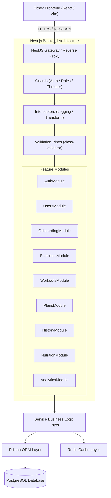
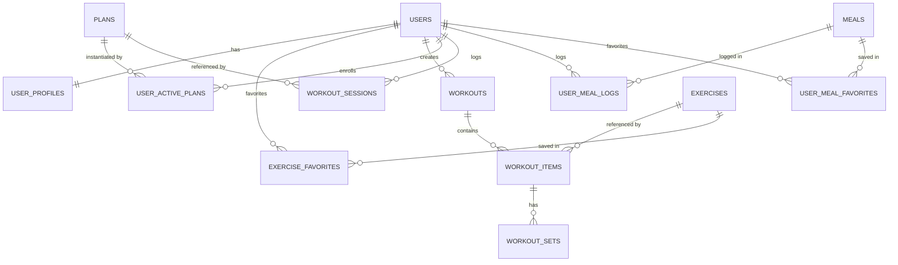

# Fitnex Backend (Nest.js) — Product Requirements Document (PRD)

**Document Version:** 1.0.0  
**Status:** Approved for Implementation  
**Target Backend Framework:** Nest.js (TypeScript, Node.js)  
**Database:** MongoDB with Mongoose ODM (`@nestjs/mongoose`)  
**Email Integration:** Nodemailer with Mailtrap SMTP  
**API Documentation:** Swagger / OpenAPI (`@nestjs/swagger`)  
**Frontend Client:** React 18 + Vite (`fitnex-fe`)  

---

## 1. Executive Summary & Vision

### 1.1 Purpose
Fitnex is a modern web application featuring an exercise database (1,324 animated movements), customizable workout builder, live guided training engine with auto rest timers and speech synthesis, onboarding calorie/macro calculator, weekly training plans with automated progression, and goal-tailored nutrition planning.

Currently, the frontend client simulates persistence and authentication using local browser storage (`localStorage` / `sessionStorage`). This PRD specifies the complete architecture, domain models, RESTful API endpoints, security protocols, and business logic required to develop a cloud-native, high-performance, fully typed **Nest.js backend**.

### 1.2 Core Architectural Principles
* **Modular Monolith**: Organized into clean, cohesive NestJS feature modules following Domain-Driven Design (DDD) principles.
* **Type Safety & Validation**: Strict DTOs (Data Transfer Objects) leveraging `class-validator` and `class-transformer` for comprehensive request validation.
* **API Standardization**: Clean RESTful API adhering to JSON:API standards, documented interactively with OpenAPI (Swagger).
* **Security First**: Stateless JWT authentication (access + refresh token pattern), argon2/bcrypt password hashing, helmet protection, CORS governance, and rate-limiting throttling.
* **Low Latency & High Read Throughput**: Redis caching for static exercise datasets and user configuration facets to guarantee sub-30ms P95 query response times.

---

## 2. System Architecture



### 2.1 Technology Stack Selection
| Component | Technology | Rationale |
| :--- | :--- | :--- |
| **Runtime & Framework** | Node.js + Nest.js 10.x (TypeScript) | Enterprise-ready DI, modular architecture, type safety, decorators. |
| **ORM & Migrations** | Prisma ORM 5.x | Auto-generated TypeScript types, declarative migrations, high developer ergonomics. |
| **Primary Database** | PostgreSQL 16 | ACID compliance, native JSONB support (for exercise steps/translations), rock-solid relational integrity. |
| **In-Memory Cache** | Redis 7.x | Fast session invalidation, rate-limiting store, caching 1,324 exercise queries. |
| **Authentication** | Passport.js + `@nestjs/jwt` | Industry-standard JWT access token + refresh token rotation. |
| **Documentation** | `@nestjs/swagger` | Real-time OpenAPI 3.0 interactive documentation generated from decorators. |
| **Containerization** | Docker & Docker Compose | Single-command local spin-up for Nest backend, Postgres, and Redis. |

---

## 3. Database Schema & Data Models



### 3.1 Entity Specifications

#### 1. `User` & `UserProfile`
* `User`:
  * `id`: UUID (Primary Key)
  * `email`: String (Unique, Indexed, Lowercase)
  * `passwordHash`: String
  * `salt`: String
  * `name`: String
  * `avatar`: String (Nullable)
  * `role`: Enum (`USER`, `ADMIN`)
  * `createdAt`: Timestamp
  * `updatedAt`: Timestamp
* `UserProfile`:
  * `id`: UUID (Primary Key)
  * `userId`: UUID (Unique Foreign Key -> `User.id`)
  * `goal`: Enum (`muscle`, `fat`, `strength`, `fit`)
  * `level`: Enum (`beginner`, `intermediate`, `advanced`)
  * `daysPerWeek`: Integer (default 3)
  * `age`: Integer (default 25)
  * `sex`: Enum (`male`, `female`)
  * `weightKg`: Float
  * `heightCm`: Float
  * `weightUnit`: Enum (`kg`, `lbs`)
  * `heightUnit`: Enum (`cm`, `ft`)
  * `activityLevel`: Enum (`sedentary`, `light`, `moderate`, `very_active`, `extra_active`)
  * `dietGoal`: Enum (`loss`, `maintain`, `gain`)
  * `bmr`: Integer
  * `tdee`: Integer
  * `targetCalories`: Integer
  * `targetProteinGrams`: Integer
  * `targetCarbsGrams`: Integer
  * `targetFatGrams`: Integer
  * `language`: Enum (`en`, `ur`, `es`, `fr`, `de`, `it`, `tr`, `ru`, `pl`, `hi`, `zh`, `ko`)
  * `voiceGuidelines`: Boolean (default true)
  * `restTimerSeconds`: Integer (default 60)
  * `theme`: Enum (`system`, `light`, `dark`)

#### 2. `Exercise` & `ExerciseFavorite`
* `Exercise`:
  * `id`: String (e.g., `"0001"`, Primary Key)
  * `name`: String (Indexed)
  * `target`: String (e.g., `"upper back"`, `"quads"`, Indexed)
  * `bodyPart`: String (e.g., `"back"`, `"legs"`, Indexed)
  * `equipment`: String (e.g., `"barbell"`, `"body weight"`, Indexed)
  * `gifUrl`: String
  * `imageUrl`: String
  * `steps`: JSONB (Array of English instruction strings)
  * `i18n`: JSONB (Localized instructions for `ur`, `es`, `fr`, `de`, `it`, `tr`, `ru`, `pl`, `hi`, `zh`, `ko`)
* `ExerciseFavorite`:
  * `id`: UUID (Primary Key)
  * `userId`: UUID (Foreign Key -> `User.id`)
  * `exerciseId`: String (Foreign Key -> `Exercise.id`)
  * Unique Constraint on `(userId, exerciseId)`

#### 3. `Workout`, `WorkoutItem`, `WorkoutSet`
* `Workout`:
  * `id`: UUID (Primary Key)
  * `userId`: UUID (Foreign Key -> `User.id`)
  * `name`: String (default `"My Workout"`)
  * `isTemplate`: Boolean (default false)
* `WorkoutItem`:
  * `id`: UUID (Primary Key)
  * `workoutId`: UUID (Foreign Key -> `Workout.id`)
  * `exerciseId`: String (Foreign Key -> `Exercise.id`)
  * `orderIndex`: Integer
* `WorkoutSet`:
  * `id`: UUID (Primary Key)
  * `workoutItemId`: UUID (Foreign Key -> `WorkoutItem.id`)
  * `setNumber`: Integer
  * `targetReps`: Integer (default 10)
  * `targetWeightKg`: Float (default 20.0)
  * `isCompleted`: Boolean (default false)

#### 4. `Plan` & `UserActivePlan`
* `Plan`:
  * `id`: String (Slug, Primary Key, e.g. `"muscle-building"`)
  * `name`: String
  * `category`: String
  * `tagline`: String
  * `description`: Text
  * `level`: String
  * `durationWeeks`: Integer (default 4)
  * `schedule`: JSONB (Weekly layout of routines per day)
* `UserActivePlan`:
  * `id`: UUID (Primary Key)
  * `userId`: UUID (Foreign Key -> `User.id`)
  * `planId`: String (Foreign Key -> `Plan.id`)
  * `currentWeek`: Integer (1-4)
  * `currentDayIndex`: Integer (0-6)
  * `enrolledAt`: Timestamp
  * `completedAt`: Timestamp (Nullable)
  * `isActive`: Boolean (default true)

#### 5. `WorkoutSession` (History & Logging)
* `WorkoutSession`:
  * `id`: UUID (Primary Key)
  * `userId`: UUID (Foreign Key -> `User.id`)
  * `planId`: String (Nullable)
  * `routineTitle`: String
  * `dateKey`: String (e.g. `"2026-11-24"`, Indexed)
  * `durationSeconds`: Integer
  * `totalVolumeKg`: Float
  * `completedSets`: Integer
  * `completedReps`: Integer
  * `caloriesBurned`: Integer
  * `prsCount`: Integer (default 0)
  * `trainedTargets`: JSONB (Array of muscle groups worked, e.g. `["upper back", "biceps"]`)
  * `exerciseSnapshots`: JSONB (Snapshot of all completed sets, weights, and reps)
  * `completedAt`: Timestamp

#### 6. `Meal`, `UserMealLog`, `UserMealFavorite`
* `Meal`:
  * `id`: String (Slug, Primary Key, e.g. `"grilled-chicken-rice"`)
  * `name`: String
  * `category`: Enum (`breakfast`, `lunch`, `dinner`, `snack`, `pre-workout`, `post-workout`)
  * `goals`: JSONB (Array: `["muscle", "strength"]`)
  * `targetMuscles`: JSONB (Array: `["chest", "back"]`)
  * `brief`: Text
  * `imageUrl`: String
  * `calories`: Integer
  * `protein`: Integer
  * `carbs`: Integer
  * `fat`: Integer
  * `fiber`: Integer
  * `ingredients`: JSONB
  * `prepTimeMinutes`: Integer
  * `tags`: JSONB
* `UserMealLog`:
  * `id`: UUID (Primary Key)
  * `userId`: UUID (Foreign Key -> `User.id`)
  * `mealId`: String (Foreign Key -> `Meal.id`)
  * `dateKey`: String (Indexed)
  * `mealType`: String
  * `loggedCalories`: Integer
  * `loggedProtein`: Integer
  * `loggedCarbs`: Integer
  * `loggedFat`: Integer
  * `createdAt`: Timestamp

---

## 4. REST API Endpoint Specifications

All endpoints are prefixed with `/api/v1`.

### 4.1 Authentication & Profile (`/api/v1/auth`, `/api/v1/users`)
| Method | Endpoint | Description | Auth Required |
| :--- | :--- | :--- | :--- |
| `POST` | `/auth/signup` | Register new user with email, password, name, and optional onboarding profile. | No |
| `POST` | `/auth/login` | Authenticate user, return JWT access token and set refresh token cookie. | No |
| `POST` | `/auth/refresh` | Rotate access token using valid refresh token. | Refresh Token |
| `POST` | `/auth/logout` | Invalidate refresh token in Redis / session store. | Yes |
| `GET` | `/users/me` | Fetch currently authenticated user and profile. | Yes |
| `PATCH` | `/users/me/profile` | Update user settings (language, units, theme, voiceGuidelines, restTimer). | Yes |
| `PUT` | `/users/me/password` | Update account password (requires old password verification). | Yes |

### 4.2 Onboarding & Metabolic Engine (`/api/v1/onboarding`)
| Method | Endpoint | Description | Auth Required |
| :--- | :--- | :--- | :--- |
| `POST` | `/onboarding/calculate` | Compute Mifflin-St Jeor BMR, TDEE, calories, and macros without mutating DB. | No |
| `POST` | `/onboarding/submit` | Save full onboarding profile (stats, goal, level, calibrated macros) for signed-in user. | Yes |

#### Mifflin-St Jeor Calculation Specification:
$$\text{BMR}_{\text{male}} = 10 \times \text{weight}_{\text{kg}} + 6.25 \times \text{height}_{\text{cm}} - 5 \times \text{age} + 5$$
$$\text{BMR}_{\text{female}} = 10 \times \text{weight}_{\text{kg}} + 6.25 \times \text{height}_{\text{cm}} - 5 \times \text{age} - 161$$
$$\text{TDEE} = \text{BMR} \times \text{Multiplier}_{\text{activity}}$$
$$\text{Target Calories} = \begin{cases} \max(1200, \text{TDEE} - 500) & \text{if dietGoal} = \text{loss} \\ \text{TDEE} + 350 & \text{if dietGoal} = \text{gain} \\ \text{TDEE} & \text{if dietGoal} = \text{maintain} \end{cases}$$
$$\text{Protein} = \frac{\text{Target Calories} \times 0.30}{4}, \quad \text{Carbs} = \frac{\text{Target Calories} \times 0.40}{4}, \quad \text{Fat} = \frac{\text{Target Calories} \times 0.30}{9}$$

### 4.3 Exercise Library (`/api/v1/exercises`)
| Method | Endpoint | Description | Auth Required |
| :--- | :--- | :--- | :--- |
| `GET` | `/exercises` | Query paginated exercises with filtering (bodyPart, target, equipment, search). | Optional |
| `GET` | `/exercises/facets` | Fetch aggregation counts for bodyParts, target muscles, and equipment types. | Optional |
| `GET` | `/exercises/:id` | Fetch detailed exercise specifications and multi-lingual steps. | Optional |
| `GET` | `/exercises/favorites/me` | Fetch array of user's favorited exercise IDs. | Yes |
| `POST` | `/exercises/:id/favorite` | Toggle favorite state for an exercise. | Yes |

### 4.4 Workout Builder (`/api/v1/workouts`)
| Method | Endpoint | Description | Auth Required |
| :--- | :--- | :--- | :--- |
| `GET` | `/workouts/current` | Retrieve the user's active builder workout draft and items. | Yes |
| `PUT` | `/workouts/current` | Save or overwrite full builder workout state (items, sets, target reps/weight). | Yes |
| `POST` | `/workouts/current/items` | Add exercise item to builder workout. | Yes |
| `DELETE` | `/workouts/current/items/:itemId` | Remove item from builder workout. | Yes |
| `POST` | `/workouts/load-routine` | Load pre-configured routine template into builder. | Yes |

### 4.5 Training Plans & Programs (`/api/v1/plans`)
| Method | Endpoint | Description | Auth Required |
| :--- | :--- | :--- | :--- |
| `GET` | `/plans` | Retrieve all workout plan templates grouped by category and goal. | Optional |
| `GET` | `/plans/:id` | Retrieve single plan details, weekly schedule, and progression metadata. | Optional |
| `GET` | `/plans/active/me` | Retrieve the user's currently active enrolled plan, current week, and day. | Yes |
| `POST` | `/plans/enroll` | Enroll user in a plan (sets `currentWeek = 1`, `currentDayIndex = 0`). | Yes |
| `POST` | `/plans/active/progress` | Advance active plan day or week upon workout completion. | Yes |
| `POST` | `/plans/active/cancel` | Cancel and unenroll from the active plan. | Yes |

### 4.6 Workout Sessions & History (`/api/v1/history`)
| Method | Endpoint | Description | Auth Required |
| :--- | :--- | :--- | :--- |
| `GET` | `/history` | Fetch paginated workout completion logs for user. | Yes |
| `POST` | `/history` | Log a completed live workout session (duration, volume, sets, reps, muscle targets). | Yes |
| `GET` | `/history/streak` | Compute current consecutive training days streak. | Yes |
| `GET` | `/history/prs` | Retrieve personal records per exercise (highest weight, highest volume). | Yes |

### 4.7 Nutrition & Meal Planner (`/api/v1/meals`)
| Method | Endpoint | Description | Auth Required |
| :--- | :--- | :--- | :--- |
| `GET` | `/meals` | Retrieve meals with filtering by goal (`muscle`, `fat`, `fit`), category, and macros. | Optional |
| `GET` | `/meals/:id` | Retrieve comprehensive meal recipe, ingredients, and macro distribution. | Optional |
| `GET` | `/meals/favorites/me` | Retrieve user's saved meals. | Yes |
| `POST` | `/meals/:id/favorite` | Toggle favorite state for a meal. | Yes |
| `POST` | `/meals/log` | Log a consumed meal against user's daily calorie/macro target. | Yes |
| `GET` | `/meals/daily-summary` | Retrieve calories & macros consumed today vs user target. | Yes |

### 4.8 Dashboard & Aggregates (`/api/v1/dashboard`)
| Method | Endpoint | Description | Auth Required |
| :--- | :--- | :--- | :--- |
| `GET` | `/dashboard/summary` | Consolidated dashboard query: active plan status, weekly streak, total workouts, volume lifted this week, daily calorie progress. | Yes |

---

## 5. Security, Validation & Business Rules

### 5.1 Validation Rules
* **Authentication**: Password strength enforced via regex (min 8 chars, 1 uppercase, 1 lowercase, 1 number, 1 symbol).
* **Sanitization**: All strings trimmed and HTML-escaped to prevent XSS.
* **Volume Normalization**: Server verifies that logged volume matches $\sum (\text{weight} \times \text{reps})$ and rejects negative or corrupted workout entries.
* **At Least 1 Set Rule**: Workouts require at least one completed set per selected exercise to log completion.

### 5.2 Error Handling & Standard Responses
Every API response adheres to a uniform structure:
```json
{
  "success": true,
  "statusCode": 200,
  "data": {},
  "timestamp": "2026-11-24T12:00:00.000Z"
}
```
Errors return standardized NestJS exception payloads:
```json
{
  "success": false,
  "statusCode": 400,
  "error": "Bad Request",
  "message": ["weight must be a positive number"],
  "timestamp": "2026-11-24T12:00:00.000Z"
}
```

---

## 6. Implementation Roadmap

### Phase 1: Foundation & Infrastructure (NestJS Scaffolding)
1. Initialize NestJS TypeScript project in `fitnex-be/` (`@nestjs/cli`).
2. Configure Docker Compose for PostgreSQL 16 and Redis 7.
3. Configure Prisma ORM, write schema models, and run initial migrations.
4. Establish global ValidationPipe, TransformInterceptor, HttpExceptionFilter, and Swagger OpenAPI setup.

### Phase 2: Auth, User Management & Onboarding Engine
1. Implement `AuthModule` with Passport JWT and Refresh Token strategy.
2. Implement `UsersModule` with profile CRUD and settings persistence.
3. Implement `OnboardingModule` with Mifflin-St Jeor mathematical calculation engine.

### Phase 3: Exercises Catalog & Seed Migration
1. Seed PostgreSQL with all 1,324 exercises from `fitnex-fe/public/data/exercises.json`.
2. Populate localized step arrays from `fitnex-fe/public/data/steps/*.json`.
3. Implement `ExercisesModule` with high-performance cached facet search.

### Phase 4: Workout Builder & Programs Engine
1. Implement `WorkoutsModule` supporting draft sync and custom routines.
2. Seed pre-built training plans (`muscle-building`, `abs-building`, `boulder-shoulders`, `weight-loss`, etc.).
3. Implement `PlansModule` with week-by-week progression and enrollment logic.

### Phase 5: Workout Sessions, Live Logging & Analytics
1. Implement `HistoryModule` with set-by-set validation, volume tracking, and streak calculation.
2. Implement personal records (PR) detection on session submission.
3. Implement `DashboardModule` for single-request dashboard metrics.

### Phase 6: Nutrition, Meal Planner & Daily Calorie Tracking
1. Seed 28 meal recipes from `fitnex-fe/src/data/meals.js`.
2. Implement `NutritionModule` with meal logging and daily macro tracker.

### Phase 7: Client Integration & Verification
1. Create an API client in `fitnex-fe` (Axios / TanStack Query) to replace localStorage adapters.
2. Validate auth tokens, session preservation, and live guided workout synchronization.
