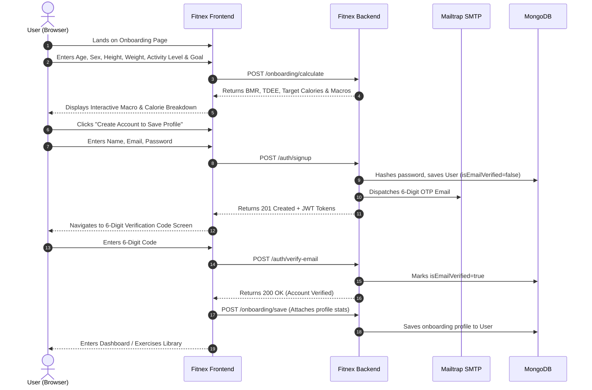
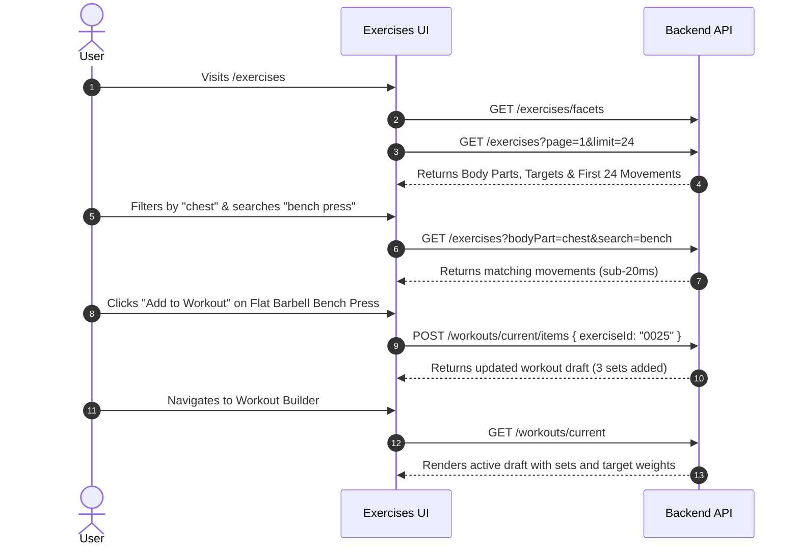
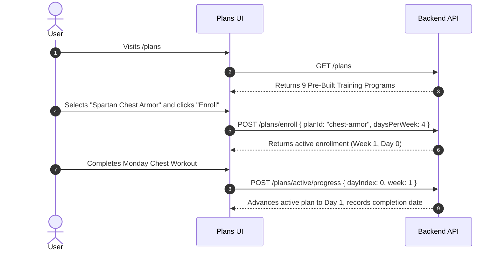

# Fitnex — End-to-End User Journeys (USER_FLOW.md)

This document visualizes the complete step-by-step user journeys through Fitnex.

---

## Flow 1: New User Onboarding & Registration

---

## Flow 2: Exploring Movements & Building a Workout

---

## Flow 3: Enrolling & Progressing in a Training Plan

